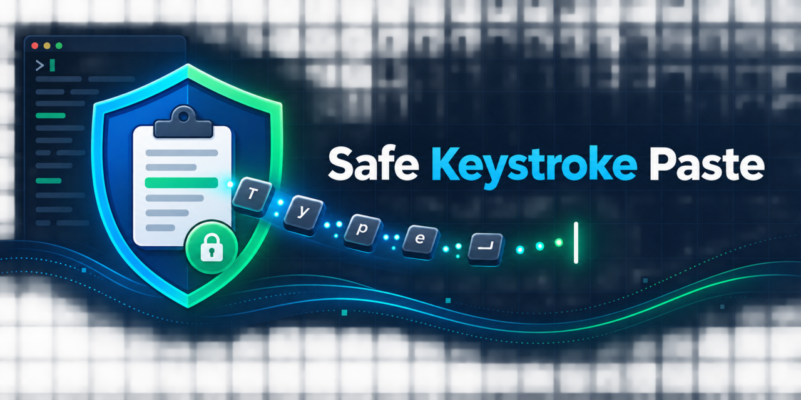

# Safe Keystroke Paste



Safe Keystroke Paste previews, validates, and deliberately paces clipboard text
before typing it as synthetic keyboard input on Linux. It is intended for
restricted remote-desktop environments where ordinary clipboard redirection is
unavailable.

It is not clipboard synchronization. It is a guarded input injector.

## Safety model

The default workflow:

1. Takes one immutable snapshot of the Wayland text clipboard.
2. Opens an editable preview, with an option to replace line breaks with spaces.
   Edits leave the system clipboard unchanged. Text length is unrestricted.
3. Requires valid text and explicit approval before typing. Empty text, line
   breaks, tabs, and control characters cannot be sent.
4. Hides the preview and waits 500 ms for the intended window to regain focus.
5. Types through `ydotool` with a 15 ms delay between key events.
6. Rejects concurrent transmissions and accepts cancellation through a private
   per-user Unix socket.

Clipboard contents are never written to logs or persistent files.

## Important limitations

- Keystrokes go to whichever window has focus. Wayland intentionally does not
  provide a portable API for proving the active target window.
- The receiving application does not acknowledge inserted characters.
- Keyboard layout and Unicode support depend on `ydotool` and the active system
  layout.
- A compositor, remote-desktop client, or security policy can alter or reject
  synthetic input.
- Do not use this tool for secrets, administrative shells, multiline commands,
  or other high-consequence input.

## Requirements

- Linux with Wayland
- Python 3.11 or later
- PyQt6
- `wl-clipboard`
- `ydotool` with a working `ydotoold` service and `/dev/uinput` permissions

On Ubuntu/Kubuntu:

```bash
sudo apt install python3-pyqt6 wl-clipboard ydotool
```

## Installation

From a checkout:

```bash
python3 -m pip install --user .
```

For distribution-managed Python installations, use `pipx` or a virtual
environment.

## Usage

Preview and send the active clipboard:

```bash
skpaste send
```

Validate and preview without injecting anything:

```bash
skpaste send --dry-run
```

Cancel an active delay or transmission:

```bash
skpaste cancel
```

The provided desktop entry can be assigned to a compositor-level shortcut. If
a remote-desktop client inhibits global shortcuts while grabbing the keyboard,
release its keyboard grab before invoking Safe Keystroke Paste.

## Why not paste normally?

Ordinary clipboard redirection is preferable when policy permits it. Some RDP
gateways intentionally block the clipboard virtual channel. Existing
"clipboard as keystrokes" features often queue an entire clipboard immediately,
without preview, length limits, pacing, single-flight protection, or
cancellation. This project provides those missing guardrails without replacing
the remote-desktop client.

## Development

```bash
python -m pip install -e '.[dev]'
ruff check .
pytest
```

The test suite never injects real keyboard input; it uses a fake `ydotool`
backend.

## License

MIT
